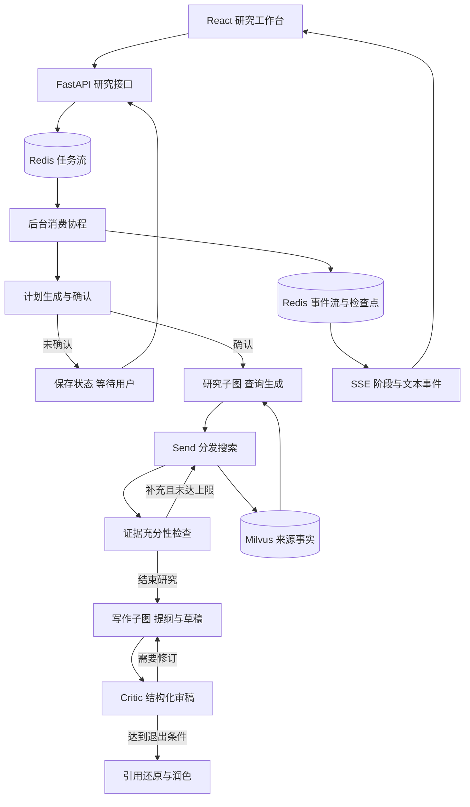

# DeepResearch Agent

一个从研究主题出发，经用户确认研究计划、并行搜集资料、检查证据缺口，再生成带来源引用报告的多智能体应用。研究与写作分别封装为LangGraph子图，任务通过Redis Streams调度，前端展示计划、搜索与报告生成进度。

这是一个个人独立开发项目，重点探索长任务编排、研究证据复用、可控迭代写作与应用工程的结合。

[系统架构](docs/architecture.md) · [配置与运行](docs/setup.md) · [开发与验证](docs/development.md)

## 解决什么问题

行业调研需要先确定范围，再围绕多个问题搜集材料，区分新旧事实，最后组织成报告。直接让模型一次性写作，容易混淆研究边界、遗漏关键证据，也不便于知道某个结论来自哪里。

本项目把这些工作拆开：先生成可检查的计划；用户确认后再研究；研究阶段按查询分发搜索，并围绕证据缺口有限追加；写作阶段依次生成提纲、草稿和结构化审稿意见，最后还原来源链接。历史事实可以进入知识库，但复用时需要考虑时效性。

## 核心能力

| 能力 | 实现方式 | 代码入口 |
| --- | --- | --- |
| 研究计划 | 主题生成计划，等待用户确认或修改后续接 | [主图](backend/src/agent/graph.py) |
| 并行检索 | 查询生成后使用LangGraph `Send`分发搜索任务 | [研究子图](backend/src/agent/sub_agents/research_agent.py) |
| 缺口反思 | 结构化判断证据是否充分，生成补充查询，受轮数限制 | [研究子图](backend/src/agent/sub_agents/research_agent.py) |
| 迭代写作 | 提纲、草稿、Critic审稿、有限次修订、引用与润色 | [写作子图](backend/src/agent/sub_agents/writer_agent.py) |
| 结构化模型输出 | Pydantic约束反思、计划判断及审稿结果，解析JSON输出 | [Schema](backend/src/agent/tools_and_schemas.py)、[Post](backend/src/agent/post.py) |
| 来源追溯 | 搜索结果维护短引用到原URL的映射，写作结束还原引用 | [研究子图](backend/src/agent/sub_agents/research_agent.py)、[写作子图](backend/src/agent/sub_agents/writer_agent.py) |
| 事实知识库 | 从摘要提取带来源、类别、置信度和时间的事实，存入Milvus | [FactStore](backend/src/agent/kb/fact_store.py)、[提取器](backend/src/agent/kb/extractor.py) |
| 知识生命周期 | 主题新鲜度、分类TTL、置信度衰减和年龄提示 | [生命周期](backend/src/agent/kb/lifecycle.py) |
| 任务与进度 | Redis Streams任务队列、图检查点、事件流与SSE | [task_queue.py](backend/src/agent/task_queue.py) |
| 账号与会话 | PostgreSQL用户、bcrypt密码、Redis Cookie会话 | [认证模块](backend/src/agent/auth/routes.py)、[数据模型](backend/src/agent/db/models.py) |
| 可选精排 | 知识库和Web结果可独立开启Cross-Encoder Rerank | [reranker.py](backend/src/agent/reranker.py) |

## 使用流程

例如研究“某类AI开发工具的产品能力与商业模式”：

1. 输入研究对象、时间范围、关注维度与希望得到的报告结构。
2. 查看系统生成的研究计划；补充或调整范围，确认后继续。
3. 研究子图拆出多条查询，检索公开资料，并将可复用的来源事实写入知识库。
4. 反思节点检查缺口；不足时补充搜索，达到轮数上限后结束研究。
5. 写作子图先生成提纲和草稿，再按结构化问题清单修订。
6. 输出Markdown报告与引用来源，在界面回看各阶段进度。

## 架构



图中的研究和写作是职责分离的子图，不是任意Agent自由协商。并行发生在研究查询的`Send`分发；当前队列worker逐条读取任务，不能由查询并行推导出全局多任务并发调度。

## 技术栈

| 层次 | 技术 | 职责 |
| --- | --- | --- |
| 前端 | React 19、TypeScript、Vite、Tailwind CSS、react-markdown | 登录、计划确认、研究时间线、报告展示 |
| 服务 | FastAPI、Uvicorn、异步Python | 研究提交、模型列表、认证及SSE |
| 编排 | LangGraph、StateGraph、Send、子图、Redis Checkpointer | 阶段路由、查询分发、状态与续接 |
| 任务 | Redis Streams、Consumer Group | 排队、消费、事件记录 |
| 业务数据 | PostgreSQL、SQLAlchemy Async、asyncpg | 用户和研究线程关联 |
| 知识 | Milvus、Embedding、可选DashScope Rerank | 来源事实存储和检索 |
| 模型 | OpenAI兼容接口、DashScope应用搜索、Pydantic | 计划、搜索摘要、反思和写作 |

搜索缓存、事件流、用户会话与图检查点都使用Redis，但数据结构和保留策略不同。PostgreSQL保存用户业务数据，Milvus保存可检索事实，不能用缓存替代这两类持久化数据。

## 项目结构

```text
backend/
  langgraph.json                 LangGraph开发入口
  src/agent/
    app.py                       HTTP接口和应用生命周期
    graph.py                     主图与计划确认
    state.py                     图状态及列表归并规则
    sub_agents/                  研究、写作子图
    task_queue.py                任务消费、检查点和事件流
    base_agent.py                模型代理、搜索与限流重试
    llm/                         兼容模型客户端
    kb/                          事实提取、存储和生命周期
    auth/                        Cookie会话与认证
    db/                          用户、线程关联及初始化
frontend/src/
  lib/useResearchStream.ts       提交研究与消费SSE
  components/ActivityTimeline.tsx 阶段时间线
  components/ResearchStreamChatView.tsx 研究交互
docs/                            架构、配置和开发说明
```

## 快速开始

需要Python 3.11、Node.js、PostgreSQL、带Search/JSON模块的Redis及Milvus，同时准备聊天、Embedding和搜索服务凭据。

```bash
git clone https://github.com/amazingLH/deepresearch-agent.git
cd deepresearch-agent/backend
python -m venv .venv
# Windows：.venv\Scripts\activate
# Linux/macOS：source .venv/bin/activate
python -m pip install -e . loguru redis ipython
```

复制`.env.example`为`.env`并填写配置，然后在`backend`执行：

```bash
python -m agent.db.init_db
uvicorn agent.app:app --host 127.0.0.1 --port 2024
```

另开终端进入`frontend`，执行`npm ci`和`npm run dev`。前端通过Vite代理访问本机`2024`端口。默认初始化账号、模型列表、搜索应用设置及图开发入口见[配置与运行](docs/setup.md)。

## 开发验证记录

| 检查项 | 已记录结果 | 口径 |
| --- | --- | --- |
| 报告引用检查 | 37条引用，36条有来源支持，1条支持较弱 | 一个研究主题的组件评测 |
| 计划质量 | 4.67/5 | 需求覆盖、问题清晰度及结构的综合评分 |
| 工程回归 | 57项通过 | 任务队列、模型配置和知识生命周期三组定向测试 |

引用数量和分数对应原有开发记录，不作为所有研究主题的质量承诺。报告审稿中的`0～10`分与上述计划质量`0～5`分是不同量表。更详细的检查方法见[开发与验证](docs/development.md)。

## 后续改进

- 补齐队列Pending消息接管、唯一消费者标识和失败任务策略。
- 完善SSE事件ID、断线续读与有限历史保留的交互。
- 增加研究任务与事件读取的owner约束，以及请求参数限额。
- 扩充独立来源核验与跨主题回归，区分模型自审和外部验证。

## 文档导航

| 文档 | 内容 |
| --- | --- |
| [系统架构](docs/architecture.md) | 主图、子图、状态、来源、知识时效、队列与SSE |
| [配置与运行](docs/setup.md) | 服务依赖、密钥、角色模型、登录、启动及故障定位 |
| [开发与验证](docs/development.md) | 接口载荷、事件、代码阅读路径、验证矩阵和扩展点 |

## 评测协议与结果汇总

[评测模块](benchmarks/evaluation/README.md)定义分层测试范围、指标分母、证据记录和结果汇总命令。范围配置与实际结果分开保存，汇总报告同时输出覆盖检查及原始记录指纹。
